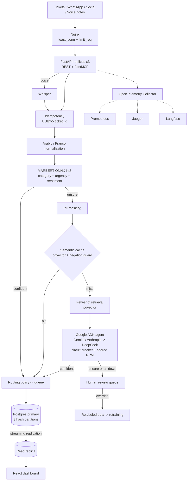

# Arabic Complaint Triage

[](https://github.com/Mrwanawad/Arabic-Complaint-Triage-using-FastAPI-Google-ADK-MARBERT-pgvector-OpenTelemetry-React/actions/workflows/ci.yml)


A production-style triage service for telecom support complaints written in **Egyptian Arabic, Franco-Arabic ("el net wa2e3"), English, or a mix**, sent as text or voice notes. Each message gets a category, an urgency and a sentiment, and is routed to the right support queue in near real time.

<p align="center"></p>

The core idea is **escalation by confidence**:

1. A fine-tuned **MARBERT** encoder, exported to ONNX int8, handles confident traffic on CPU in about 10 ms.
2. Uncertain messages go to a **Google ADK** agent that routes between Gemini and Anthropic, with DeepSeek as the fallback. PII is masked first, a semantic cache answers repeats, and similar labeled complaints are retrieved as few-shot examples.
3. Anything still uncertain lands in a durable **human review queue**. Reviewer overrides become new training data.

The full design, including the trade-offs, is in [architecture.md](architecture.md).

---

## Highlights

- **Arabic-first NLP.** Rule-based normalization for dialect text: script detection, alef, ya and ta marbuta unification, diacritic and tatweel stripping, repeated-letter collapse, emoji tokens, and Franco-Arabic transliteration (2, 3, 5, 7 to letters).
- **Multi-head encoder.** One MARBERT model predicts category, urgency and sentiment together. It is quantized to int8 and agrees with PyTorch on 93% of categories (163 MB, p50 9 ms and p95 14 ms on CPU).
- **LLM escalation with failover.** Google ADK with structured output and schema validation, weighted Gemini and Anthropic primaries, DeepSeek fallback through LiteLLM, a circuit breaker per provider, and a requests-per-minute budget shared across replicas.
- **No Redis by design.** pgvector HNSW for the semantic cache and few-shot retrieval, an UNLOGGED Postgres table for shared rate limits, Nginx `limit_req` at the edge, and a deterministic UUIDv5 primary key for idempotency.
- **Safety.** PII (phones, national IDs, emails, customer IDs) is masked before any external call or cache write. A negation guard stops "النت شغال" from reusing the cached answer for "النت مش شغال". Prompts fence the complaint against injection.
- **Scalable topology.** Three stateless API replicas behind Nginx `least_conn`, a Postgres primary with a streaming hot-standby replica that serves dashboards, and `tickets` hash-partitioned 8 ways.
- **Two inbound doors, one core.** REST (FastAPI) and an MCP tool (FastMCP) share the same use cases. Voice notes go through Whisper first.
- **Full observability.** OpenTelemetry traces and metrics go through the Collector to Prometheus and Jaeger, and to Langfuse over OTLP when configured. Metrics cover drift, tokens per provider, new-slang rate, replica lag and human-override rate.
- **MLOps loop.** MLflow tracking, Optuna tuning, cleanlab label-quality checks exported as Label Studio tasks, LIME explanations, Evidently drift reports, DeepEval and RAGAS suites, and Compose smoke tests in CI.

---

## Architecture



The code follows **hexagonal architecture (ports and adapters)**. The domain and use cases import no framework. Every vendor sits behind a port, and `bootstrap.py` is the single composition root.

```
src/triage/
  domain/        labels, routing policy, normalization, PII masking (standard library only)
  application/   ports + use cases: classify, review, ingest voice note, dashboard
  adapters/
    inbound/     FastAPI, FastMCP
    outbound/    ONNX encoder, TF-IDF baseline, LightGBM, ONNX embedder, ADK escalator,
                 Postgres (tickets, cache, rate limiter, examples), Whisper, OpenTelemetry
  bootstrap.py   builds adapters from settings and injects them into use cases
```

**Failure behavior**

| Failure | What happens |
|---|---|
| One LLM provider down | Its circuit opens and traffic moves to the next provider |
| All providers down or over budget | Encoder result kept, ticket goes to human review. No complaint is dropped |
| Read replica down | Dashboard falls back to the primary |
| Telemetry backend down | Telemetry is dropped; triage is unaffected |
| Same webhook delivered twice | Same `ticket_id`, stored result returned |

---

## Tech stack

| Area | Tools |
|---|---|
| Serving | FastAPI, Pydantic, Uvicorn, ONNX Runtime, FastMCP |
| Models | MARBERT (Hugging Face Transformers, PyTorch), TF-IDF + calibrated LinearSVC, LightGBM, faster-whisper |
| LLM orchestration | Google ADK, LiteLLM; Gemini, Anthropic, DeepSeek |
| Retrieval and cache | Multilingual MiniLM sentence embeddings (ONNX), PostgreSQL + pgvector (HNSW) |
| Data and training | pandas, NumPy, scikit-learn, imbalanced-learn, Optuna, MLflow, cleanlab, LIME |
| EDA | Matplotlib, Seaborn, Plotly Express, wordcloud with arabic-reshaper and python-bidi |
| Evaluation | DeepEval, RAGAS, pytest, custom routing and cache evaluators |
| Observability | OpenTelemetry SDK and Collector, Prometheus, Jaeger, Langfuse, Evidently |
| Infrastructure | Docker, Docker Compose, Nginx, Postgres streaming replication, Render blueprint |
| Frontend | React 18, TypeScript, Vite, Plotly |
| Quality | GitHub Actions, ruff, pytest (126 tests) |

Deliberately left out, each with a reason in [architecture.md](architecture.md#tools-not-used-and-why): Redis, LangChain and other agent frameworks, Kafka, Kubernetes, LoRA, and multi-node sharding.

---

## Methodology

**Data and labels.** A synthetic generator builds 992 complaints from templates across the four scripts. Splits are made **by template**, so the test set never contains a paraphrase of a training row. cleanlab flags likely label noise and exports it as Label Studio tasks for relabeling.

**Models.**
- The TF-IDF + LinearSVC baseline is calibrated so its probabilities are meaningful. It stays selectable with `?model=baseline`.
- MARBERT is fine-tuned with a shared encoder and three heads, using class-weighted loss and stratified splits, with Optuna tuning and MLflow tracking.
- Export goes through ONNX with dynamic int8 quantization, and the int8 model is checked against PyTorch.
- LightGBM urgency (encoder probabilities plus channel, hour and repeat count) is **gated**: it serves only if it strictly beats the encoder's urgency head without losing recall. On simulated metadata it tied, so it does not serve.

**Metrics.** Macro-F1 is the primary metric, so rare classes count. High-urgency recall comes next, because a missed outage is the costly error. Every result is sliced by script (Arabic, Franco, English, mixed). Serving reports p50/p95 latency and the ONNX vs PyTorch delta.

**Thresholds from evidence.** `training/evaluate_routing.py` sweeps the auto-route threshold against accuracy. The semantic cache threshold was picked on same-meaning and opposite-meaning pairs, including negation.

**LLM evaluation.** DeepEval runs a golden set of 15 hard cases: dialect, Franco, negation, a thank-you, line misuse and a prompt injection. A custom deterministic metric checks the label match. RAGAS measures few-shot retrieval, read alongside exact label precision@k.

**Production monitoring.** The service tracks category distribution shift, mean confidence and the low-confidence rate, the unknown-token (new slang) rate, the human-override rate, tokens and failovers per provider, and replica lag.

---

## Results

> All model numbers come from **synthetic template data**. They prove the pipeline works end to end, not how it performs on real complaints. Replace `data/synthetic.csv` with labeled tickets before trusting any metric.

| Check | Result |
|---|---|
| Category macro-F1, MARBERT vs baseline | 0.66 vs 0.74 |
| High-urgency recall, MARBERT vs baseline | **0.90** vs 0.61 |
| Sentiment macro-F1, MARBERT vs baseline | **0.73** vs 0.65 |
| MARBERT category accuracy after int8 export | 0.87 |
| ONNX int8 size, CPU latency p50 / p95 | 163 MB, 9 / 14 ms |
| int8 agreement with PyTorch | category 93%, urgency 93%, sentiment 99.5% |
| Auto-routing at threshold 0.80 | 62% of tickets, 100% category accuracy, 0 urgent tickets missed |
| Semantic cache at threshold 0.97 | 50% useful hits on 12 same-meaning pairs, **0 wrong hits** on 14 different-meaning pairs |
| Few-shot label precision@5 | 0.44 (RAGAS context precision 0.71, recall 0.80, fuzzy-matched) |
| DeepEval golden set, offline (baseline answering) | 10 / 15 |
| Voice note to routed ticket in the container | under 1 s once Whisper is warm |
| Memory per API container | about 0.8 GB, 1.0 GB with Whisper loaded |

Known weakness: the multilingual embedder is weak on Arabic word order, and a reordered sentence scored only 0.18. Try a stronger Arabic embedder if retrieval matters on real data.

---

## What is verified

| Verified | How |
|---|---|
| ADK Runner, structured output, schema validation | Unit tests |
| Failover over real HTTP, circuit breaker, malformed output | ADK -> LiteLLM -> a local stub of DeepSeek's OpenAI-compatible API |
| Semantic cache hits and the negation guard, PII masking | Unit tests and the cache evaluator |
| Idempotency under concurrency, shared rate limit, hash partitions | Tests against real PostgreSQL + pgvector |
| Streaming replication, dashboard reads from the replica | Replication tests and Compose smoke checks |
| 3 replicas behind Nginx, hot standby, edge 429s, Prometheus, Jaeger | `scripts/compose_smoke.sh` in CI on every push |
| MARBERT and Whisper inside the container | Compose stack with the real artifacts |
| Render-style boot | Image run alone: downloads the bundle, checks SHA-256, listens on `$PORT` |
| Client-key auth on `/classify` and `/mcp` | HTTP tests and the running stack |
| Langfuse-style OTLP export | Spans reach a local receiver with the Basic auth header |
| DeepEval harness without keys | `EVAL_PROVIDER=offline` runs the real ADK and LiteLLM path against the baseline |

**Not verified yet**, because each needs a paid key or an account: calls to the real Gemini, Anthropic and DeepSeek APIs, the DeepEval suite against them, Langfuse accepting the traces, and a live Render deployment.

---

## Quick start

### Setup

```bash
uv venv --python 3.12
uv pip install -e ".[dev,train,eval,voice]"
```

### Train

Run from the repository root.

```bash
python -m training.generate_synthetic
python -m training.eda                    # optional: charts and word clouds
python -m training.train_baseline
python -m training.train_encoder --epochs 4
python -m training.tune                   # optional: Optuna search
python -m training.export_onnx
python -m training.train_urgency
python -m training.label_quality          # cleanlab -> Label Studio tasks
python -m training.explain                # LIME on sample predictions
python -m training.drift_report           # Evidently text drift
```

The embedder goes in `artifacts/embedder/` as `model.onnx` and `tokenizer.json`, taken from the ONNX folder of `sentence-transformers/paraphrase-multilingual-MiniLM-L12-v2`. Without it, the service falls back to a lexical hashing embedder meant only for development.

Whisper `base` can be bundled in `artifacts/whisper/` (the `Systran/faster-whisper-base` files: `model.bin`, `config.json`, `tokenizer.json`, `vocabulary.txt`). Without it, each replica downloads the weights from Hugging Face. Either way the service loads Whisper in the background at startup, so the first voice note does not hit the Nginx timeout.

### Run

Without Docker, using an embedded PostgreSQL:

```bash
PYTHONPATH=src:. ADMIN_API_KEY=choose-a-key python scripts/dev_server.py --seed data/synthetic.csv
```

With the full topology, copy `.env.example` to `.env`, fill it in, then:

```bash
docker compose up --build --scale api=3
```

| Service | URL |
|---|---|
| Console and API (through Nginx) | http://localhost:8080 |
| Swagger | http://localhost:8080/docs |
| Jaeger | http://localhost:16686 |
| Prometheus | http://localhost:9090 |
| MLflow | http://localhost:5000 |

Seed the few-shot store once the database is up:

```bash
DATABASE_URL=postgresql://triage:<POSTGRES_PASSWORD>@localhost:5432/triage python -m training.seed_examples
```

### Deploy to Render

The image ships no models, so build a bundle, host it where the service can download it, and set its URL and checksum:

```bash
tar -czf artifacts.tar.gz -C artifacts .
sha256sum artifacts.tar.gz
```

Set `ARTIFACTS_URL` and `ARTIFACTS_SHA256` on the service. The blueprint ([render.yaml](render.yaml)) uses a 2 GB instance and generates both the admin key and a client key.

### Test

```bash
pytest tests -q
pytest evals/test_escalation_deepeval.py -m live                         # calls paid providers
EVAL_PROVIDER=offline pytest evals/test_escalation_deepeval.py -m live   # no keys, baseline behind a local API
python -m evals.eval_retrieval_ragas
python -m evals.eval_semantic_cache
python -m training.evaluate_routing
bash scripts/compose_smoke.sh                                            # against a running Compose stack
```

---

## API

```bash
curl -X POST localhost:8080/classify \
  -H "Content-Type: application/json" \
  -H "X-API-Key: $CLIENT_KEY" \
  -d '{"text": "el net wa2e3 men embare7", "channel": "whatsapp", "external_id": "msg-1"}'
```

| Endpoint | Purpose | Auth |
|---|---|---|
| `POST /classify` | One message; add `?model=baseline` to compare | Client key |
| `POST /classify/batch` | Up to 64 messages | Client key |
| `POST /classify/voice` | Voice note, multipart field `audio` | Client key |
| `GET /review` | Pending tickets, masked text only | Admin key |
| `POST /review/{id}` | Human decision | Admin key |
| `GET /dashboard` | Aggregates, served from the read replica | Admin key |
| `GET /health`, `GET /metrics` | Health and Prometheus metrics | None |
| `/mcp` | MCP tool `classify_complaint` | Client key |

Client-key routes accept any key in `CLIENT_API_KEYS` (or the admin key), sent as `X-API-Key` or, for MCP, as `Authorization: Bearer <key>`. When `CLIENT_API_KEYS` is empty, these routes are open. That suits local development only, because they write tickets and can trigger paid LLM calls.

---

## Repository layout

| Path | Contents |
|---|---|
| `src/triage/domain` | Labels, routing policy, normalization, PII masking |
| `src/triage/application` | Ports and use cases |
| `src/triage/adapters` | FastAPI, FastMCP, ONNX, LightGBM, ADK, Postgres, Whisper, OpenTelemetry |
| `src/triage/bootstrap.py` | Composition root |
| `training/` | Synthetic data, EDA, baseline, MARBERT, Optuna, ONNX export, LightGBM, cleanlab, LIME, drift, routing eval |
| `evals/` | DeepEval golden set and offline provider, RAGAS retrieval, semantic cache eval |
| `frontend/` | React review console and dashboard |
| `deploy/` | Nginx, Postgres replication, OpenTelemetry Collector, Prometheus |
| `scripts/` | Embedded-Postgres dev server, Compose smoke checks |
| `.github/workflows/ci.yml` | Lint, tests, frontend build, Docker build, Compose topology smoke run, manual LLM evals |
